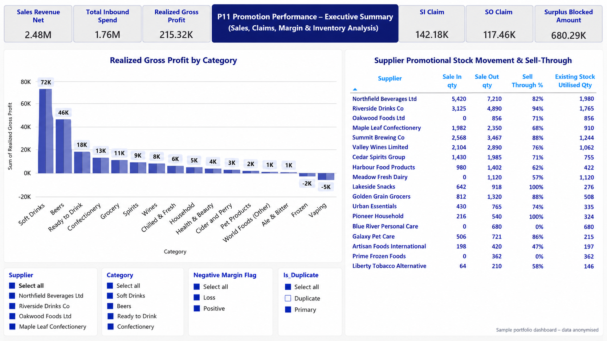
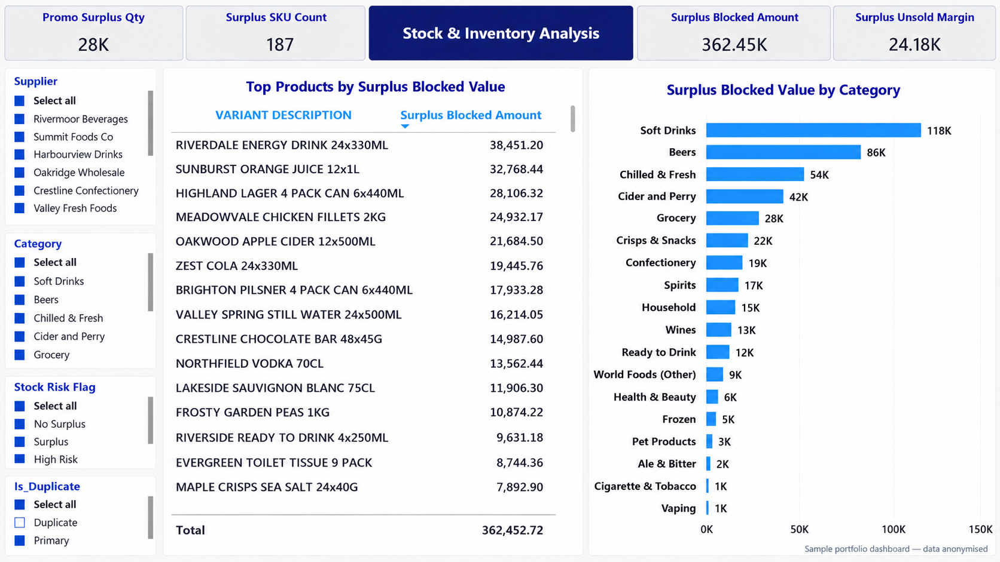
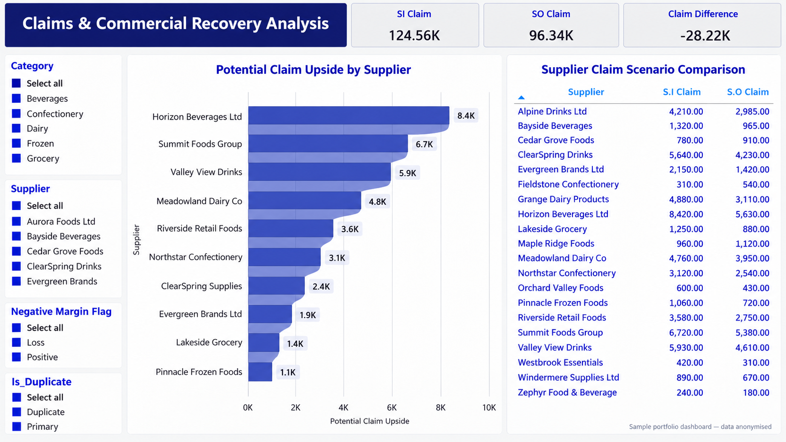
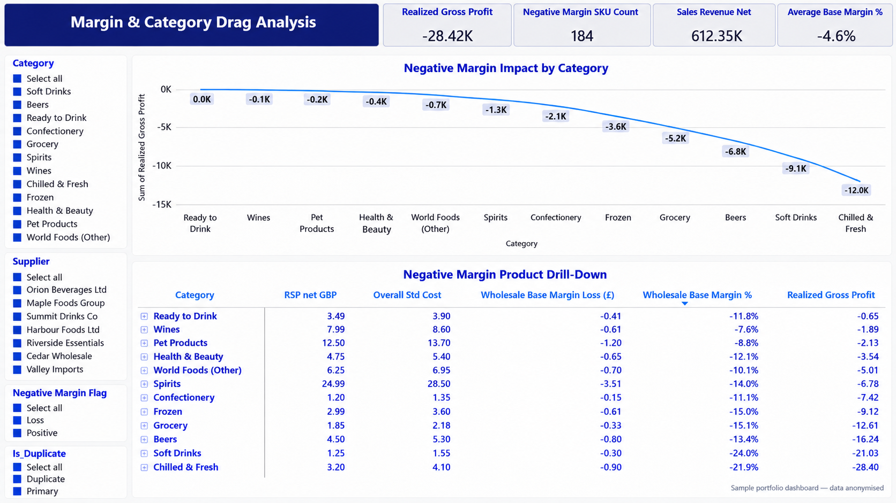
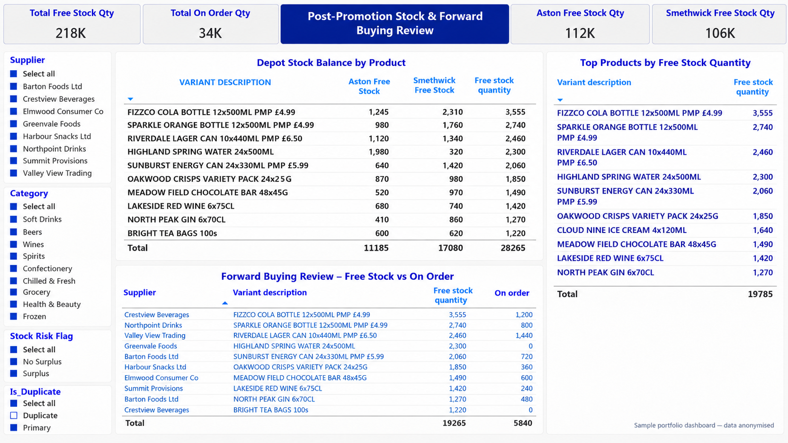

# P11 Promotion & Variant Analysis | Power BI

### Promotional Performance • Inventory Risk • Supplier Claims • Margin Analysis

## Project Overview

This project presents an analysis of promotional sales, product variants, supplier claims and stock performance in a wholesale distribution setting, using Microsoft Power BI and Excel.

The objective was to bring sales, purchasing, margin and inventory information into a clear set of dashboards, helping identify promotional performance, surplus stock exposure, negative margins and products requiring a closer buying review.

**Portfolio data note:** The published screenshots use sample data and anonymised supplier/product labels for demonstration. The values illustrate the analytical approach and should not be treated as reported company results.

## Business Objectives

- Compare sales revenue, inbound spend and realised gross profit.
- Review supplier promotional stock movement and sell-through.
- Identify surplus product variants and the value tied up in remaining stock.
- Compare S.I. and S.O. claim views to support commercial review.
- Highlight negative-margin products and their contribution to category performance.
- Compare depot stock balances with outstanding orders to support forward-buying decisions.

## Tools and Skills

| Tool or Skill | Application |
|---|---|
| Microsoft Power BI | Sales, claims, margin and inventory dashboards |
| Microsoft Excel | Supporting data review and analysis |
| Data Visualisation | KPI cards, category comparisons, supplier tables and filters |
| Commercial Analysis | Promotional performance, supplier claims and margin review |
| Inventory Analysis | Surplus stock, depot balances and forward-buying review |

## Dashboard Gallery

### Dashboard 1 — Promotion Performance: Executive Summary

An overview of net sales revenue, inbound spend, realised gross profit, promotional claims and surplus stock value, alongside category profitability and supplier sell-through.

### Dashboard 2 — Stock & Inventory Analysis

A review of surplus quantities, affected product variants and blocked stock value, with product and category comparisons to help prioritise inventory investigation.

### Dashboard 3 — Claims & Commercial Recovery Analysis

A comparison of S.I. and S.O. claim scenarios, showing supplier-level differences and potential claim opportunities for further review.

### Dashboard 4 — Margin & Category Drag Analysis

A review of negative-margin products, selling prices, standard costs and category-level profit impact to identify areas requiring closer commercial investigation.

### Dashboard 5 — Post-Promotion Stock & Forward Buying Review

A comparison of free stock across depots and quantities already on order, helping identify products that need a stock review before additional purchasing.

## Analytical Insights

**Promotional Performance**

Reviewing sales alongside realised gross profit and supplier sell-through provides a broader view of promotional performance than revenue alone.

**Surplus Stock Exposure**

Product and category comparisons help identify where remaining stock holds the greatest value and where stock movement needs closer attention.

**Supplier Claims**

Differences between claim scenarios identify areas for reconciliation and supplier follow-up. Potential claim values require validation against the relevant promotional terms.

**Margin Pressure**

Comparing selling prices, costs and realised gross profit helps highlight products whose sales may be accompanied by weak or negative margins.

**Forward Buying**

Reviewing existing stock together with open orders supports a more informed assessment of replenishment needs and potential overstock exposure.

## Business Recommendations

1. Prioritise a review of products with the highest surplus stock value.
2. Validate negative-margin products against their selling prices and recorded costs.
3. Reconcile promotional claim differences against agreed supplier terms.
4. Review free stock and outstanding orders before placing further purchases.
5. Use supplier and category performance to inform future promotional and buying reviews.

These recommendations describe potential actions arising from the analysis; they do not claim implemented changes, recovered claims or verified financial savings.

## Project Outcome

This project demonstrates commercial and operational analysis across promotional sales, supplier claims, product margins and inventory.

It shows how structured reporting can help buying, sales and operations teams prioritise product-level investigations and make more informed decisions.

---

**Created by Meena Sathiya**

MSc Computer Science (Distinction) | Power BI | Excel | Data Analysis

[GitHub Profile](https://github.com/Meena-Sathiya) | [Portfolio Website](https://meena-sathiya.github.io/Portfolio-website/)

*The published dashboard images are static portfolio previews using sample data.*
